# 🌟 MirrorMind v2 — Complete End-to-End ML Pipeline Architecture

```mermaid
flowchart LR
    %% STYLING
    classDef stepBox fill:#1E293B,stroke:#38BDF8,stroke-width:2px,color:#F8FAFC,rx:8,ry:8;
    classDef phaseTitle fill:#0F172A,stroke:#64748B,stroke-width:1px,color:#38BDF8,font-weight:bold;
    classDef highlight fill:#0284C7,stroke:#38BDF8,stroke-width:2px,color:#FFFFFF,font-weight:bold;
    classDef outputBox fill:#064E3B,stroke:#10B981,stroke-width:2px,color:#ECFDF5,rx:8,ry:8;

    subgraph P1 ["STAGE 1: CANONICAL INPUT"]
        direction TB
        A["👤 Student Profile<br>• Skills: Python, FastAPI, Docker, React<br>• CGPA: 8.8 | Projects: 3 | Internships: 1"]:::stepBox
        A --> B["Deterministic Serializer<br><code>build_profile_text()</code><br><i>(Anti-Leakage Guard)</i>"]:::stepBox
        B --> C["Canonical Text Narrative<br>'Engineering student with skills in...<br>CGPA 8.8. Completed 3 projects...'"]:::stepBox
    end

    subgraph P2 ["STAGE 2: SEMANTIC EMBEDDING"]
        direction TB
        C --> D["WordPiece Tokenizer<br>Vocab V = 30,522<br>[CLS], [SEP], ##subwords"]:::stepBox
        D --> E["all-MiniLM-L6-v2<br>6-Layer Transformer Backbone<br>12 Multi-Head Self-Attentions"]:::stepBox
        E --> F["Mean Pooling + L2 Norm<br>||v||₂ = 1.0000 on S³⁸³<br><b>Dense 384-D Vector</b>"]:::highlight
    end

    subgraph P3 ["STAGE 3: PYTORCH CareerMLP"]
        direction TB
        F --> G["Dense Block 1: 384 ➔ 512<br>BatchNorm1d + GELU + Dropout(0.35)<br><i>Feature Disentanglement</i>"]:::stepBox
        G --> H["Dense Block 2: 512 ➔ 256<br>BatchNorm1d + GELU + Dropout(0.35)<br><i>Noise Compression</i>"]:::stepBox
        H --> I["Dense Block 3: 256 ➔ 128<br>BatchNorm1d + GELU + Dropout(0.245)<br><i>Candidate Bottleneck</i>"]:::stepBox
        I --> J["Output Linear Layer: 128 ➔ 10<br>Raw Logits z ∈ ℝ¹⁰<br>z[SWE_BACKEND] = +5.42"]:::highlight
    end

    subgraph P4 ["STAGE 4: PROBABILITY CALIBRATION"]
        direction TB
        J --> K["Softmax Probability Layer<br>P(yᵢ) = exp(zᵢ) / Σ exp(zⱼ)<br>Sum = 100.0%"]:::stepBox
        K --> L["Calibrated Role Spectrum<br>🥇 SWE_BACKEND: <b>78.9%</b><br>🥈 FULLSTACK_DEV: <b>16.9%</b><br>🥉 DEVOPS_CLOUD: <b>3.0%</b><br>Other 7 Tracks: <b>< 1.2%</b>"]:::outputBox
    end

    subgraph P5 ["STAGE 5: REASONING & OUTPUT"]
        direction TB
        L --> M["5-Pillar Skill Radar<br>• Frameworks: 92/100<br>• Core Coding: 88/100<br>• Data & Math: 88/100<br>• Engineering: 82/100<br>⚠️ Cloud/System: 64/100 (Gap)"]:::stepBox
        M --> N["Multi-Platform Action<br>• Next.js Visualizer Dashboard<br>• Flutter Mobile App<br>• Real-time Voice Copilot & Vector RAG"]:::outputBox
    end

    P1 ==> P2 ==> P3 ==> P4 ==> P5
```

---

## 📋 Step-by-Step Viva Presentation Walkthrough

| Step | Component | Operation & Transformation | Mathematical Form |
| :---: | :--- | :--- | :--- |
| **1** | **Input Profile** | Skills, CGPA, Projects, Internships sanitized into standard narrative. | Target titles stripped (Zero-Leakage Guard) |
| **2** | **Tokenizer** | WordPiece splits words into tokens and subwords. | $[101, 18750, 3435, 18567, \dots, 102]$ |
| **3** | **Bi-Encoder** | 6-Layer Transformer self-attention maps context to 384 dimensions. | Mean-Pooled & L2-Normalized: $\|\mathbf{v}\|_2 = 1.0$ |
| **4** | **PyTorch MLP** | Funnel through $384 \to 512 \to 256 \to 128 \to 10$ with BatchNorm1d & GELU. | $\mathbf{h} = \text{GELU}(\text{BN}(\mathbf{W}\mathbf{x} + \mathbf{b}))$ |
| **5** | **Output Logits** | 10 real numbers emitted (positive $=$ match, negative $=$ mismatch). | $\mathbf{z}_{\text{backend}} = +5.42, \mathbf{z}_{\text{iot}} = -4.65$ |
| **6** | **Softmax** | Converts raw logits into calibrated probability percentages. | $P(\text{Backend}) = 78.9\%, P(\text{Fullstack}) = 16.9\%$ |
| **7** | **Radar & Voice** | 5-Pillar Spider Chart highlights strengths and warns about cloud gaps. | Voice Copilot explains gap analysis via TTS |
